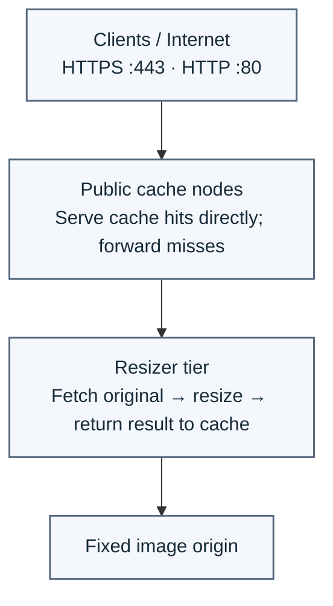

# Steady NGINX Image Resizer

A small reference implementation of on-demand image resizing with NGINX, preserving the simple URI model:

    /77x77/path/to/image.png

The [NGINX image filter module](https://nginx.org/en/docs/http/ngx_http_image_filter_module.html) performs the transformation; the [NGINX proxy module](https://nginx.org/en/docs/http/ngx_http_proxy_module.html) handles upstream requests and response caching. The [NGINX map module](https://nginx.org/en/docs/http/ngx_http_map_module.html) maps a query argument to a cache-bypass flag. The [NGINX core HTTP module](https://nginx.org/en/docs/http/ngx_http_core_module.html) provides the server/location and request-routing directives, the [NGINX upstream module](https://nginx.org/en/docs/http/ngx_http_upstream_module.html) configures the fixed origin upstream, and the [NGINX headers module](https://nginx.org/en/docs/http/ngx_http_headers_module.html) adds the cache-status response header. One NGINX process serves the public edge on port 8080 and a loopback-only transformer on 127.0.0.1:8082. The edge caches the already-resized response bytes.

**Reference implementation, not production-ready software.** CI integration tests are a core deliverable.

## Quick start

Requires Docker Engine and the Docker Compose plugin.

    docker compose up --build --abort-on-container-exit --exit-code-from tests

To run the demo interactively:

    docker compose up --build -d nginx origin
    curl -i http://localhost:8080/77x77/sample.png
    docker compose down

The origin serves deterministic synthetic PNG fixtures; no external image host is needed.

## Request contract

- Request format: `/{width}x{height}/{origin-relative-path}`
- Width and height are bounded to 1–2048.
- The upstream origin is fixed by configuration; clients cannot provide an arbitrary origin URL.
- The cache key includes the URI and query string, so requested sizes and query-based cache-busting versions are separate variants.
- **Bypass the cache on demand:** add `?bypass_cache=1` to a resize URL, for example `/77x77/sample.png?bypass_cache=1`. Values `1`, `true`, and `yes` are recognized. The map-based flag activates both `proxy_cache_bypass` (skip cache lookup) and `proxy_no_cache` (do not store the response). Expect `X-Cache-Status: BYPASS`.
- Cache bypass is useful for debugging or fetching a fresh upstream result; it does not purge or replace a previously cached entry.
- For ordinary source updates, use immutable/versioned source paths or a version query such as `?version=2`. A cached response for an unchanged URL can remain stale until its 10-minute cache TTL expires.
- `X-Cache-Status` exposes cache state for demo and test purposes.

## Network exposure

Only the edge service publishes a host port. The transformer server listens on 127.0.0.1:8082 inside the same container, so it is reachable by the edge but not directly reachable from other containers or the host.

## CI coverage

The integration suite exercises the real HTTP service and checks output dimensions/aspect ratio, cache MISS then HIT, map-based cache bypass (including that bypassed responses are not stored), cache-busting query variants for changed source content at the same path, variant separation, invalid dimensions, literal and encoded traversal attempts, missing origin objects, preservation of upstream 503, malformed image bytes, non-image responses, originals larger than the configured 8 MiB image-filter buffer, and concurrent same-key and distinct transformations.

## Limitations and threat model

- The [NGINX image filter module](https://nginx.org/en/docs/http/ngx_http_image_filter_module.html) is a separate module and depends on GD. Package availability and module paths vary by NGINX distribution/build.
- Format support depends on the module and GD build. The demo tests PNG only; it makes no claims about WebP, AVIF, animated images, or metadata/profile preservation.
- Cold transformations consume CPU and memory. Large originals, many sizes, and high concurrency can be expensive. The 8 MiB image-filter buffer rejects sources that exceed the configured buffer; this is not a complete memory or CPU budget for the whole service.
- Arbitrary sizes can fragment the cache; dimension bounds reduce but do not eliminate this.
- Replacing an original at the same path does not automatically invalidate an existing cached variant. Use a versioned URL/query or wait for expiry; no purge API is implemented. Cache bypass forces an upstream fetch but deliberately does not update the cache entry.
- [Proxy cache locking and stale response behavior](https://nginx.org/en/docs/http/ngx_http_proxy_module.html) still need deployment-specific testing under failure and high load.
- The edge cache is local to one instance; replicas do not share cache contents automatically.
- This is not a full image CDN or media platform. Advanced codecs, cropping, focal points, authorization, purge APIs, and global delivery are out of scope.

## Scaled-out deployment (future option)

The proposed topology keeps the request path simple: public cache nodes serve hits directly, and only misses go to the resizer tier. The resizer fetches the original image, transforms it, and returns the result to be cached.

**Possible extension:** multiple resizer hosts with peer fallback and health-aware routing. This is a future deployment option, not functionality implemented or tested by the current demo. Multi-host routing needs deliberate health checks, timeouts, TLS/trust boundaries, and cache/failover policies.

## Architecture

    client
      | GET /77x77/sample.png
      v
    NGINX edge :8080 -- proxy_cache (URI + query)
      | cache miss via loopback
      v
    NGINX transformer 127.0.0.1:8082 -- image_filter
      | fetch original over private Compose network
      v
    fixed origin :8081 -- original image

## Development

    docker compose config
    docker compose up --build --abort-on-container-exit --exit-code-from tests
    docker compose down -v

Do not make performance claims until benchmarks have been run on a stated environment.

## License

BSD 2-Clause. See LICENSE.

Copyright © 2026 Steady Infrastructure LLC.
